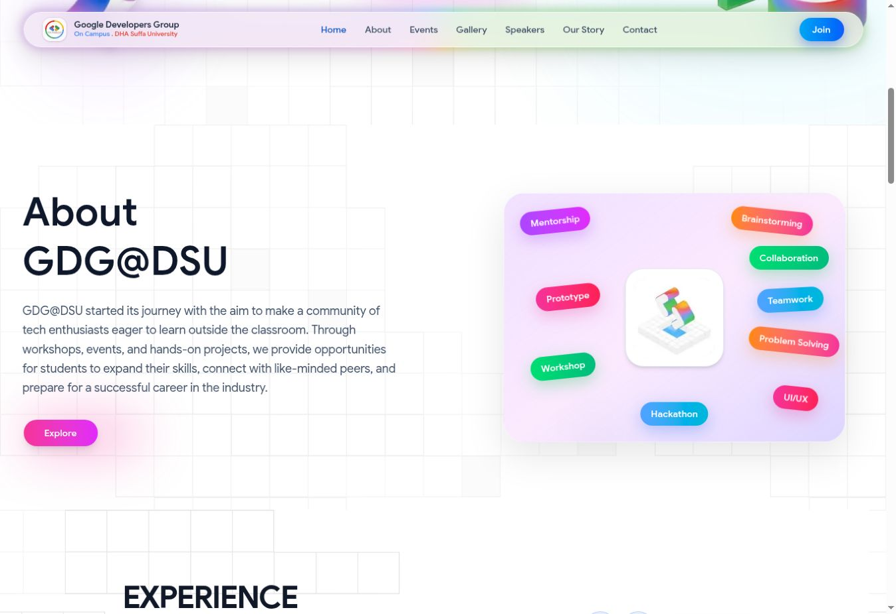
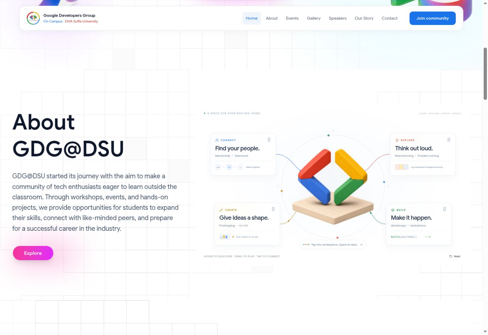
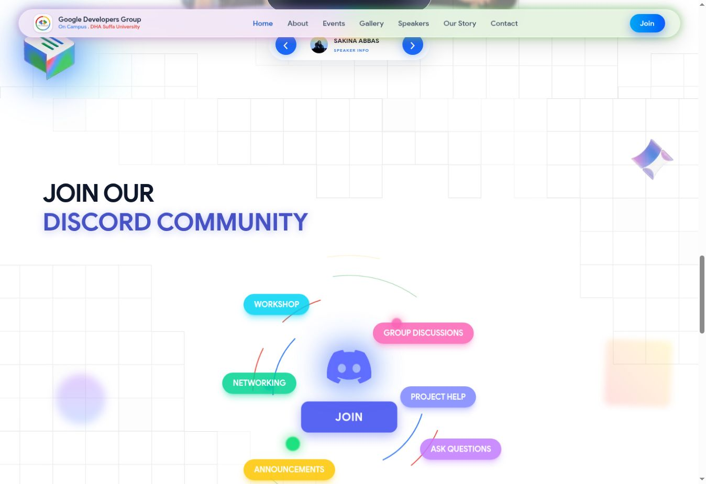
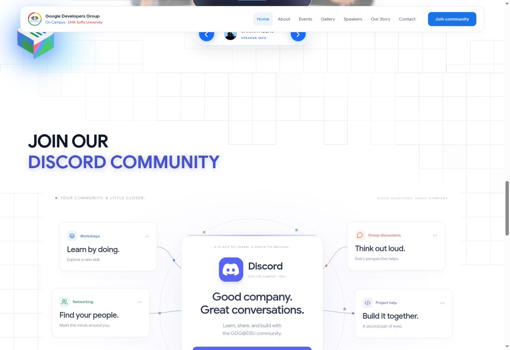
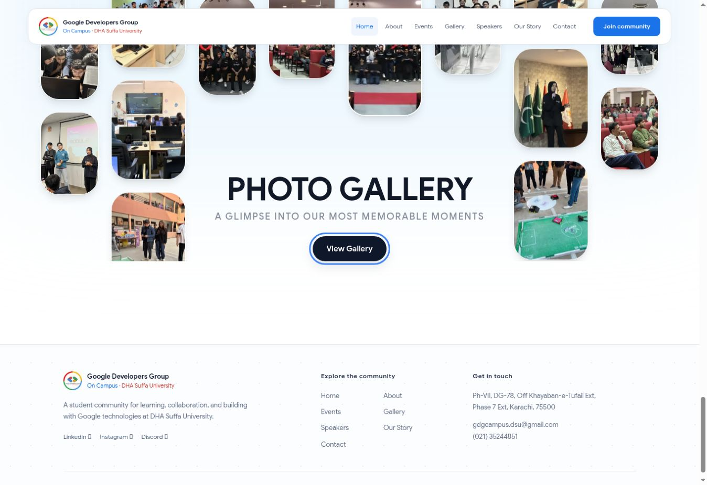

# GDG on Campus DSU — Revamped website

A six-page community website for DHA Suffa University, with the original interactive landing layout, two custom Remotion components, optional Supabase CMS, consent-based PostHog analytics, and a reproducible Vercel build.

## Start here

| Goal | What to do |
|---|---|
| Run without any service accounts | Install Node 22, run `npm ci`, then `npm run build` and `npm run preview`. |
| Let the client manage content | Follow **Supabase setup**, then edit tables through Supabase's dashboard. |
| Enable analytics | Set the two public PostHog variables and redeploy. |
| Publish on Vercel | Import this repository; `vercel.json` supplies the build settings. |
| Understand the visual changes | See **Before and after**, **Changes**, and **Performance** below. |

No production API keys are included. The complete local snapshot works without Supabase or PostHog.

## Before and after

These are actual browser captures. The “before” images show the earlier captured landing components; the “after” images show the integrated implementation. They are visual comparisons, not performance benchmarks.

### Community illustration

| Before: static label cloud | After: interactive community canvas |
|---|---|
|  |  |

### Discord illustration

| Before: orbiting labels | After: interactive community lounge |
|---|---|
|  |  |

### Gallery redirect



## Changes made to the website

1. Rebuilt six routes: Home, Events, Speakers, Gallery, Our Story, and Contact.
2. Preserved the original community content, links, branding, speaker portraits, event images, and self-hosted typography. The imported snapshot includes 23 events, 43 speaker records, and 307 album photos. Those counts describe the seed, not a permanent limit.
3. Standardized Google Sans across navigation, headings, controls, and content. Font subsets and responsive WebP derivatives reduce transfer costs.
4. Restored the earlier colorful hero, event carousel, speaker carousel, and animated photo presentation after feedback that the simpler redesign felt less lively.
5. Replaced the two generic-looking illustration layouts with the supplied custom-coded React/Remotion designs. All nine component source files and three supplied assets remain byte-identical to the approved ZIP; `docs/component-provenance.json` records their hashes.
6. Added the generated sculptural centerpiece, four draggable activity cards, animated connections, centerpiece tilt, activity details, reset behavior, and an idea mixer. The idea suggestions are examples, not claims about real events.
7. Added the Discord lounge with six selectable channels and contextual details. The official Discord symbol retains its aspect ratio. The Join link opens the intended invite and does not join a server automatically.
8. Preserved reduced-motion behavior and playback suspension when components leave the viewport or the tab is hidden. React/Remotion is loaded near the relevant section rather than at the initial hero.
9. Made both brand text lines visible beside the mobile logo; kept the responsive menu and keyboard controls.
10. Separated the partner strip and Photo Gallery with positive spacing, including space for expanded component detail panels.
11. Fixed the gallery redirect with explicit dark background, white text, visible opacity, a descriptive accessible name, and a focus outline. The button always says **View Gallery**.
12. Kept event search, date/year filtering, details, photo albums with keyboard navigation, speaker links, expanded team photos, and contact validation. Year choices now follow the content rather than a hard-coded list.
13. Added Supabase import/build scripts and read-only public policies; PostHog consent and explicit events; Vercel configuration; environment examples; CMS tests; and this deployment guide.

## Architecture

This is a static HTML website with small JavaScript interactions and two bundled React islands. It is **not a Next.js application**. Vercel serves the generated `dist/` directory directly; no always-running Node server is needed.

```text
site/                         Canonical, environment-independent page/assets source
src/components/community/     Nine original approved component files
src/remotion-islands.tsx       React mount wrappers; no demo application shell
src/services/analytics.ts      Bundled PostHog integration
scripts/prepare-site.mjs       Local snapshot or published CMS content → dist
scripts/cms-upload.mjs         Schema bootstrap (optional), assets, and seed import
scripts/publish-cms.mjs        Requests a Vercel rebuild through a Deploy Hook
supabase/schema.sql           Tables, RLS, and public read policies
vercel.json                   Static deployment and response headers
docs/screenshots/             Before/after screenshots
```

`site/` is committed; generated `dist/`, `.env.local`, `node_modules`, and provider-specific workspace metadata are excluded from the GitHub handoff. Builds always start from `site/`, so a previous CMS build cannot accidentally contaminate the next one.

## Local installation

Use Node **22.x** and npm. In a terminal:

```sh
git clone https://github.com/SarhanCoderOfTheCentury/gdg-revamped.git
cd gdg-revamped
npm ci
cp .env.example .env.local
npm run build
npm run preview
```

On Windows, copy `.env.example` to `.env.local` using Explorer if `cp` is unavailable. Open the local URL printed by the preview command.

Leave all API variables empty to use the complete local snapshot. Do not open the HTML directly with `file://`; ES module loading requires an HTTP server.

## Supabase setup

### 1. Create the project and credentials

Create a Supabase project. From its dashboard obtain:

| Variable | Meaning | Where it belongs |
|---|---|---|
| `SUPABASE_URL` | Your project URL | Local import and Vercel build |
| `SUPABASE_PUBLISHABLE_KEY` | Public publishable/legacy anon key | Local build and Vercel build |
| `SUPABASE_SERVICE_ROLE_KEY` | Private secret/service-role key | Local import only |
| `SUPABASE_STORAGE_BUCKET` | Dedicated public media bucket, default `gdg-assets` | Local import and Vercel build |
| `DATABASE_URL` | Optional privileged Postgres connection URL | Local schema bootstrap only |

The service key bypasses RLS. Never put it in browser scripts, `PUBLIC_` or `VITE_` variables, a README, a Git commit, or a screenshot. The build writes only the deliberately public PostHog configuration to the browser.

### 2. Create the schema once

A Supabase API key alone cannot create SQL tables. Choose either:

- Open Supabase **SQL Editor**, paste `supabase/schema.sql`, and run it once; or
- Put the database connection string from Supabase's **Connect** panel into `DATABASE_URL`. `cms:upload` then runs that SQL automatically before importing. URL-encode special characters in the password and retain the connection's required TLS settings. Remove `DATABASE_URL` after provisioning if no longer needed.

The schema creates `site_pages`, `events`, `speakers`, and `site_settings`. Public clients can read only published rows. Anonymous and ordinary authenticated visitors cannot insert, edit, or delete rows. Editors use the trusted Supabase dashboard; a separate custom admin application is not included.

### 3. Import the website

Populate `.env.local`, then run:

```sh
npm run cms:dry-run
npm run cms:upload
```

The dry run prints counts and makes no network writes. The actual upload:

1. Optionally creates the SQL schema using `DATABASE_URL`.
2. Checks table access before uploading anything.
3. Creates/configures the dedicated public media bucket.
4. Uploads media, illustrations, icons, font files, and image variants with the correct MIME types, using four parallel workers.
5. Upserts the seed events, speaker records, six page documents, and home carousel configuration using stable IDs.

Only public website media belongs in this bucket. Do not point the script at a bucket containing private files: it intentionally configures the chosen bucket for public reads. Application JS/CSS is built and deployed by Vercel; uploaded media is served from Supabase. Local copies remain as a complete fallback.

The import is repeatable: matching IDs and paths are updated, unrelated records are retained. **Re-importing the seed overwrites edits to those same seed rows.** Use it for initial migration or an intentional re-import, not on every deployment. A failed import can be rerun after fixing credentials or schema; no import should be treated as complete until the success message appears.

### 4. Manage content

Use Supabase **Table Editor** and **Storage**:

| Location | What the client edits |
|---|---|
| `events` | Title, description, venue, category, dates, image, photos, speakers, publication status, ordering |
| `speakers` | Name, role, portrait, LinkedIn link, publication status, ordering |
| `site_settings`, key `homeEvents` | Home carousel cards; retain the existing JSON object shape (`title`, `date`, `description`, `image`, `photos`) |
| `site_pages` | Six page titles and complete page HTML, including section copy and structure |
| Storage → dedicated bucket | Public media files; use their public URLs in content |

Page HTML is an advanced editor surface, not a drag-and-drop page builder. Only trusted editors should edit it; it can contain scripts and links. Preserve navigation, component mount elements, and runtime script references. The six core pages must remain published; a missing core page aborts the build rather than exposing an unpublished fallback.

Event changes feed the search/details runtime; speaker and album directories are regenerated from their published tables. The home carousel is selected independently through `homeEvents`. Decorative home gallery strips belong to the page HTML and do not automatically replace themselves when a new event is added.

Local `/assets/...` media references are mapped to the configured Supabase bucket during CMS builds. Full public HTTPS image URLs can also be used. Preserve a full-size album image; the bundled local snapshot also includes small thumbnails and responsive variants.

### 5. Publish CMS edits

CMS content is read **at build time**, not fetched on every page visit. This keeps page loads predictable and avoids exposing service credentials.

After editing, redeploy in Vercel. Optionally create a Vercel Deploy Hook for `main`, put its private URL into local `VERCEL_DEPLOY_HOOK`, and run:

```sh
npm run cms:publish
```

This requests a deployment; inspect Vercel's dashboard to confirm its build succeeds. There is no automatic Supabase webhook configured by this repository. A configured CMS failure aborts a deployment rather than silently publishing stale local content. With CMS variables entirely absent, local snapshot mode is intentional.

## PostHog setup

1. Create a PostHog project and choose the correct region.
2. Set `PUBLIC_POSTHOG_KEY` to its **project token**, not a personal access token.
3. Set `PUBLIC_POSTHOG_HOST`, normally `https://us.i.posthog.com` or your project's region-specific ingestion host.
4. Rebuild/redeploy. The public project token is intentionally browser visible.
5. Visit the site, choose **Allow analytics**, then check PostHog's live events.

No analytics SDK is loaded until consent is accepted. Declining keeps the SDK unloaded. The footer's **Analytics preferences** control lets visitors withdraw consent and choose again. Session recording, general autocapture, and form-text capture are disabled. The integration does not send contact names, email addresses, phone numbers, or message bodies.

| Event | Trigger |
|---|---|
| `$pageview`, `$pageleave` | Page navigation after consent |
| `community_join_clicked` | Chapter membership link |
| `discord_join_clicked` | Discord invitation link |
| `gallery_opened` | Gallery redirect link |
| `gallery_album_opened` | Album button, with event ID |
| `event_details_opened` | Event detail button, with event ID |

PostHog still processes its normal device/session metadata for enabled analytics. Set your privacy notice, region, retention, and project access appropriately before collecting real visitor traffic. Consent is stored in localStorage as `gdg-analytics-consent`. If keys are absent, analytics and its consent prompt are disabled; the website remains usable.

## Vercel deployment

Import this repository into Vercel and use the root directory:

| Setting | Value |
|---|---|
| Framework preset | Other |
| Node version | 22.x |
| Install command | `npm ci` |
| Build command | `npm run build` |
| Output directory | `dist` |

`vercel.json` already defines the build/output, clean URLs, security response headers, and a one-hour revalidation cache for assets. No SPA catch-all rewrite is needed: each of the six routes has its own generated HTML. Query-based album links remain supported.

For local content mode, no environment keys are required. For CMS mode, set `SUPABASE_URL`, `SUPABASE_PUBLISHABLE_KEY`, and the bucket name in Vercel's environment settings. Add the two public PostHog variables only when enabling tracking. **Do not add the service-role key or database password to Vercel just to build this static website.** Select Production/Preview environments deliberately and redeploy after changing variables.

The build copies local content, reads published CMS records if configured, generates public configuration, type-checks TSX, builds the two Remotion islands, and builds a separate lazily loaded analytics bundle. A build does not upload or overwrite CMS content.

## Performance: what improved, and what was restored

| Change | Why it helps | Current status |
|---|---|---|
| Google Sans font files: 6,537,468 → 269,060 bytes | About 96% smaller font asset set | Retained; supplied component WOFF2 adds about 36 KB |
| Responsive WebP sizes and 128 px album thumbnails | Avoids fetching full album images for tiny thumbnails | Retained |
| React/Remotion bundle loaded near its section | Keeps interactive component parsing off the initial hero path | Retained |
| Remotion pauses off screen and in hidden tabs | Reduces unnecessary animation work | Retained in original component code |
| Native local JS instead of copied framework hydration/tracking chunks | Removes original Next runtime and prior telemetry | Retained |
| CMS resolved at build time | Visitors receive static content rather than waiting for the database | Added |
| PostHog loaded only after consent | No analytics download/request for declining visitors | Added |
| CSS and images cached/revalidated | Reduces repeat-visit transfer while allowing updates | Added in Vercel configuration |

The temporary minimal redesign reduced home image elements from 128 to 19 and home CSS from about 282 KB to 34 KB. **Those are historical measurements, not current claims:** the animated gallery, richer layout, and carousels were subsequently restored at the user's request. The current website intentionally trades some rendering work for interaction. Remotion and analytics also add bundles when activated. There is no fabricated Lighthouse score, mobile FPS result, or claim that the current page is a fixed percentage faster.

`PERFORMANCE.md` records that earlier experiment. Use a real Vercel production deployment, representative phones, and Lighthouse/WebPageTest before making client-facing timing claims.

## Validation

```sh
npm run check
npm run build
npm run validate
node scripts/test-cms.mjs
npm run cms:dry-run
```

- TypeScript and production bundle checks cover the supplied React components.
- Static validation checks page routes, local references, content arrays, and required contact fields.
- Source integrity checks compare all nine approved component files and three assets to their original hashes.
- CMS integration tests use a local mock API to verify published reads, speaker/album rendering, storage mapping, and build failure for missing pages. They do not claim to validate a real Supabase project.
- Browser checks have covered the community mixer, card drag/reset, Escape, Discord selection and invite destination, restored carousels, phone-width layout, and gallery CTA contrast.

A live Supabase import, real RLS access tests, live PostHog event delivery, and a Vercel deployment still require the client's actual service accounts/keys. No credentials for those services were supplied during this handoff.

## Troubleshooting

| Problem | What to check |
|---|---|
| `cms:upload` cannot access a table | Run the SQL schema first; check the URL/private service key. |
| Upload stops midway | Confirm bucket permissions and retry; matching objects are upserted. |
| CMS build fails | Confirm publishable key, table grants/RLS, and six published core pages. |
| Content changes do not appear | Trigger and confirm a new Vercel deployment. |
| Images fail | Check the public bucket, object path/case, and full public URL. |
| Component is blank | Serve through HTTP, check `dist/assets/remotion`, and ensure the provided assets were uploaded/deployed. |
| No analytics events | Accept consent; check region host and public project token, browser blocking, and PostHog live events. |
| Form does not submit to a server | Contact intentionally opens the visitor's email application; no email-delivery backend is configured. |

## Source, rights, and handoff boundaries

Logos, community photos, and speaker images retain their original owners' rights. The generated centerpiece came with the approved component package. The two illustrated scenes use custom React/Remotion source rather than flattened screenshots; their component files remain unchanged. Integration wrappers, CMS/build tooling, tracking, CTA fix, and deployment configuration are separate project code.

Keep `.env.local` private. Revoke any credential shared in a chat or copied into an unintended location. No GitHub credential is required by the deployed website, and no deployment credential belongs in this repository.

Official references: [Supabase RLS](https://supabase.com/docs/guides/database/postgres/row-level-security), [Storage access](https://supabase.com/docs/guides/storage/security/access-control), [Supabase JavaScript](https://supabase.com/docs/reference/javascript/introduction), [PostHog browser SDK](https://posthog.com/docs/libraries/js), [Vercel configuration](https://vercel.com/docs/project-configuration).
